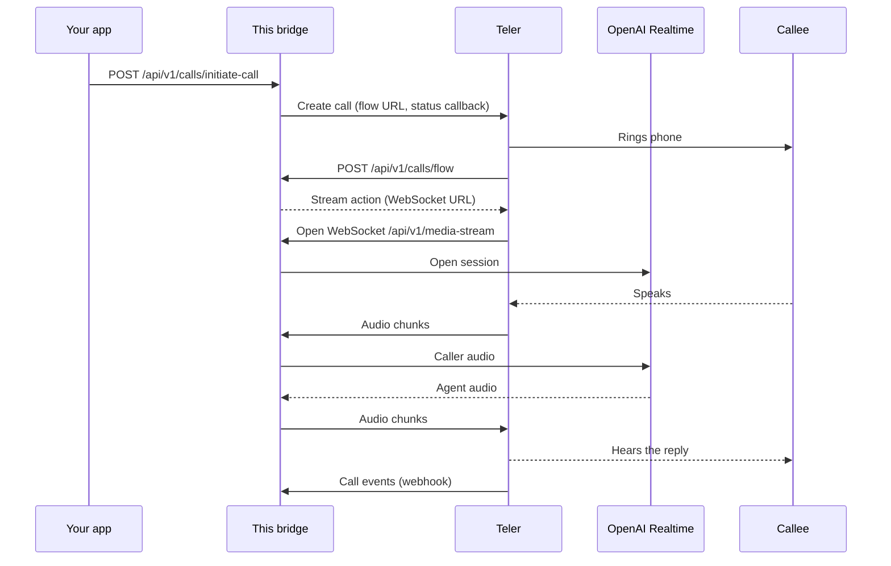

# Teler-OpenAI-Node-Bridge

[](LICENSE) [](https://nodejs.org/en/download)   [](https://frejun.com/docs/teler/)

A reference integration between Teler and openai in Node, based on [Media Streaming Bridge](https://frejun.com/docs/teler/media-streaming/bridge/) over WebSockets.

## What is Teler?

Teler is a programmable voice API by FreJun. It handles carriers, phone numbers, and real-time audio streaming so you can connect AI models directly to phone calls. → [FreJun-Teler](https://frejun.com/teler/)

## Overview

This repository connects phone calls on **Teler** to the OpenAI Realtime API. It is a Node.js (TypeScript, Express) server that places a call through the Teler API, receives the call's audio over Teler's [Media Streaming Bridge](https://frejun.com/docs/teler/media-streaming/bridge/), forwards it to OpenAI Realtime, and streams the response audio back into the call.

Use it as a working reference: run it as-is to hear OpenAI Realtime on a real phone call, then adapt the code for your own application.

## What you can build

- A speech-to-speech phone agent built on OpenAI Realtime models
- Outbound calls such as appointment confirmations, surveys or lead qualification
- A TypeScript base for adding tools and instructions to a Realtime session on phone calls

The included `POST /api/v1/calls/initiate-call` endpoint places **outbound** calls. For **inbound** calls, point your Teler number's voice app at this server's `/api/v1/calls/flow` endpoint (see [Voice apps](https://frejun.com/docs/teler/telephony/voice-apps/)).

## How it works



1. Your app calls `POST /api/v1/calls/initiate-call`. The bridge asks Teler to place the call, passing its own flow URL and webhook URL (both built from `SERVER_DOMAIN`).
2. When the call connects, Teler requests `/api/v1/calls/flow`, and the bridge answers with a **stream** action that points Teler to its WebSocket.
3. Teler opens a WebSocket to `/api/v1/media-stream` and starts sending the caller's audio.
4. The bridge opens a session with OpenAI Realtime WebSocket (`OPENAI_WS_URL`).
5. Audio flows both ways: caller audio is forwarded to OpenAI Realtime, and OpenAI Realtime's audio is sent back to Teler.
6. Audio is resampled where the rates differ: OpenAI ↔ Teler sample rates (interpolation with low-pass filtering).
7. Outgoing audio is buffered (`BUFFER_SIZE`) so Teler receives evenly sized chunks.
8. Call status events are delivered to `/api/v1/webhooks/receiver`.

More detail: [How media streaming works](https://frejun.com/docs/teler/media-streaming/how-it-works/) and [WebSocket protocol](https://frejun.com/docs/teler/media-streaming/websocket-protocol/).

## Prerequisites

- **Teler account** and API key, from the [FreJun Teler dashboard](https://platform.frejun.ai)
- A Teler phone number to call from
- OpenAI API key with Realtime API access
- **ngrok** account and auth token (used by the Docker setup to expose the server publicly)
- **Runtime:** Docker and Docker Compose (recommended). To run without Docker: Node.js 20 and npm (the Docker image uses `node:20-alpine`).
- **Public HTTPS/WSS endpoint:** Teler must reach this server from the internet for the flow URL, the media WebSocket and webhooks. The Docker setup uses ngrok for this; in production, use your own domain with TLS.
- **Outbound internet access** from the server to the Teler API and to the provider's API.
- **Ports:** `8000` (app) and `4040` (ngrok inspector) must be free on the host when using Docker Compose.


## Setup

1. **Clone and configure:**

   ```bash
   git clone https://github.com/frejun-tech/teler-openai-node-bridge.git
   cd teler-openai-node-bridge
   cp .env.example .env
   # Edit .env with your actual values
   ```

2. **Run with Docker:**
   ```bash
   docker compose up -d --build
   ```

### Run without Docker (local development)

```bash
npm install
npm run dev          # development, runs src/index.ts directly
# or
npm run build && npm run serve   # compiled build, runs dist/index.js
```

In a second terminal, run `ngrok http 8000`. With `NODE_ENV` set to anything other than `production`, the bridge detects the tunnel from `http://localhost:4040` automatically.

### Verify it is running

```bash
curl http://localhost:8000/health
curl http://localhost:8000/ngrok-status
```

Then place a test call with the request in **Call Initiation Example**.

## Environment Variables

| Variable                   | Description                   | Default  |
| -------------------------- | ----------------------------- | -------- |
| `OPENAI_WEBSOCKET_URL`     | Your OpenAI Websocket URL     | Required |
| `OPENAI_API_KEY`           | Your OpenAI API KEY           | Required |
| `OPENAI_SAMPLE_RATE`       | Audio sample rate             | 16k      |
| `BUFFER_SIZE`              | Message buffer size           | 10      |
| `TELER_API_KEY`            | Your Teler API key            | Required |
| `NGROK_AUTHTOKEN`          | Your ngrok auth token         | Required |

### Required vs optional settings

These values are taken from the code (`src/core/config.ts`). Where this table and the table above differ, the code is what runs.

| Variable | Required | Default | Description |
|---|---|---|---|
| `TELER_API_KEY` | Required | — | Teler API key, used to place calls through the Teler API |
| `OPENAI_API_KEY` | Required | — | OpenAI API key |
| `OPENAI_WS_URL` | Required | empty | OpenAI Realtime WebSocket URL. There is no default in code, so it must be set. The code reads `OPENAI_WS_URL` |
| `OPENAI_SAMPLE_RATE` | Optional | `16k` | OpenAI audio sample rate |
| `BUFFER_SIZE` | Optional | `10` | Audio chunks buffered before forwarding |
| `NGROK_AUTHTOKEN` | Required with Docker | — | ngrok auth token, read by the `ngrok` container in `docker-compose` (not by the app itself) |
| `SERVER_DOMAIN` | Optional | auto-detected | Public hostname of this server, without `https://`. Auto-detected from ngrok when it is running; set it yourself when deploying without ngrok |
| `PORT` | Optional | `8000` | Port the server listens on |
| `NODE_ENV` | Optional | `development` | `production` makes ngrok detection use the `ngrok` container (`http://ngrok:4040`); any other value uses `http://localhost:4040` |

## API Endpoints

- `GET /` - Health check with server domain
- `GET /health` - Service status
- `GET /ngrok-status` - Current ngrok status and URL
- `POST /api/v1/calls/initiate-call` - Start a new call with dynamic phone numbers
- `POST /api/v1/calls/flow` - Get call flow configuration
- `WebSocket /media-stream` - Audio streaming
- `POST /api/v1/webhooks/receiver` - Teler webhook receiver

### Call Initiation Example

```bash
curl -X POST "https://your_ngrok_domain/api/v1/calls/initiate-call" \
  -H "Content-Type: application/json" \
  -d '{
    "fromNumber": "+918064xxx",
    "toNumber": "+919967xxx"
  }'
```


## Features

- **Bi-directional media streaming** - Bridges audio between Teler and openai (Voice API) over WebSockets.
- **Real-time audio handling** - Receives live audio chunks from Teler, processes them, and forwards to openai; streams responses back to Teler.
- **High-quality audio resampling** - Converts audio between Teler and OpenAI sample rates using interpolation and low-pass filtering, minimizing distortion and preserving speech clarity during real-time streaming.
- **Dockerized setup** - Comes with Dockerfile and docker-compose.yaml for easy local development and deployment.
- **Dynamic ngrok URL detection** - Automatically detects current ngrok domain

## Troubleshooting

**`initiate-call` returns an authentication error from Teler.**
Check `TELER_API_KEY` in `.env`, then restart the container so it picks up the change. Keys are managed in the [Teler dashboard](https://platform.frejun.ai).

**The phone rings, but there is silence after answering.**
Teler could not reach the flow URL or the WebSocket. Open `/ngrok-status` and confirm a public URL is listed. If you are not using ngrok, set `SERVER_DOMAIN` to your public hostname without `https://`.

**`/ngrok-status` shows no tunnel.**
Check that `NGROK_AUTHTOKEN` is set and look at the ngrok container logs (`docker compose logs ngrok`). The free ngrok plan gives a new URL on every restart, so place calls only after the tunnel is up.

**The connection to OpenAI Realtime fails or closes immediately.**
Check the OpenAI Realtime credentials in `.env` (see **Required vs optional settings**) and the app logs (`docker compose logs app`) for the provider's error message.

**Audio is choppy or delayed.**
Tune `BUFFER_SIZE`. Smaller values reduce latency; larger values smooth playback.

**Running in Docker, the app cannot find the ngrok URL.**
Set `NODE_ENV=production` so the bridge looks for the `ngrok` container instead of `localhost:4040`.

**`Bind for 0.0.0.0:8000 failed: port is already allocated`.**
Another process is using port 8000 or 4040. Stop it, or change the host port mapping in `docker-compose`.

## Security

- **Keep secrets out of git.** Store keys only in `.env`, which is listed in `.gitignore`. Never commit real keys, and use placeholders in examples and issues.
- **Rotate keys** if you suspect a key was exposed, and use separate keys for development and production.
- **Protect the call-initiation endpoint.** `POST /api/v1/calls/initiate-call` has no authentication in this reference code, so anyone who can reach your public URL can place calls billed to your Teler account. Before exposing the server, add authentication (an API key header, for example) or restrict access by IP.
- **The flow, media and webhook endpoints are not verified** in this reference code. In production, keep the server behind your own domain and validate incoming requests.
- **Use ngrok only for development.** In production, deploy behind your own domain with TLS (`https://` and `wss://`).
- **Call recording is on by default** in this bridge. Make sure you have the consent your jurisdiction requires, or turn recording off.
- **Logs can contain call details** such as phone numbers and transcripts. Handle logs as personal data.
- **Report security issues privately** to support@frejun.com rather than in a public GitHub issue.

## Contributing

- **Report a bug or request a feature:** open an issue at [github.com/frejun-tech/teler-openai-node-bridge/issues](https://github.com/frejun-tech/teler-openai-node-bridge/issues). Include steps to reproduce, the relevant logs (with keys removed) and your environment.
- **Submit a change:** fork the repository, create a branch, make your change, and open a pull request that describes what changed and how you tested it. Keep pull requests focused on one change.
- For questions about your Teler account, contact support@frejun.com.

## Related repositories

**Same integration in Python:** [teler-openai-bridge](https://github.com/frejun-tech/teler-openai-bridge)

**Python bridges:** [cartesia](https://github.com/frejun-tech/teler-cartesia-bridge), [deepgram](https://github.com/frejun-tech/teler-deepgram-bridge), [devnagri](https://github.com/frejun-tech/teler-devnagri-bridge), [elevenlabs](https://github.com/frejun-tech/teler-elevenlabs-bridge), [gemini](https://github.com/frejun-tech/teler-gemini-bridge), [openai](https://github.com/frejun-tech/teler-openai-bridge), [ultravox](https://github.com/frejun-tech/teler-ultravox-bridge), [vapi](https://github.com/frejun-tech/teler-vapi-bridge)

**Node.js bridges:** [cartesia](https://github.com/frejun-tech/teler-cartesia-node-bridge), [deepgram](https://github.com/frejun-tech/teler-deepgram-node-bridge), [devnagri](https://github.com/frejun-tech/teler-devnagri-node-bridge), [elevenlabs](https://github.com/frejun-tech/teler-elevenlabs-node-bridge), [gemini](https://github.com/frejun-tech/teler-gemini-node-bridge), [sarvam](https://github.com/frejun-tech/teler-sarvam-node-bridge), [ultravox](https://github.com/frejun-tech/teler-ultravox-node-bridge), [vapi](https://github.com/frejun-tech/teler-vapi-node-bridge)

**Other Teler references:** [teler-wav-bridge](https://github.com/frejun-tech/teler-wav-bridge), [teler-livekit-outbound](https://github.com/frejun-tech/teler-livekit-outbound), [teler-openai-sip-trunking](https://github.com/frejun-tech/teler-openai-sip-trunking)

**SDKs:** [teler-py](https://github.com/frejun-tech/teler-py) (Python), [teler-node](https://github.com/frejun-tech/teler-node) (Node.js)

## Documentation

- [Teler documentation](https://frejun.com/docs/teler/)
- [Quickstart](https://frejun.com/docs/teler/get-started/quickstart/)
- [Media Streaming Bridge](https://frejun.com/docs/teler/media-streaming/bridge/)
- [OpenAI Realtime recipe](https://frejun.com/docs/teler/recipes/openai-realtime/)
- [API reference](https://frejun.com/docs/teler/api-reference/)
- [FreJun Teler](https://frejun.com/teler/)
- [Teler dashboard](https://platform.frejun.ai)

## License

This project is licensed under the MIT License. See [LICENSE](LICENSE) for details.
